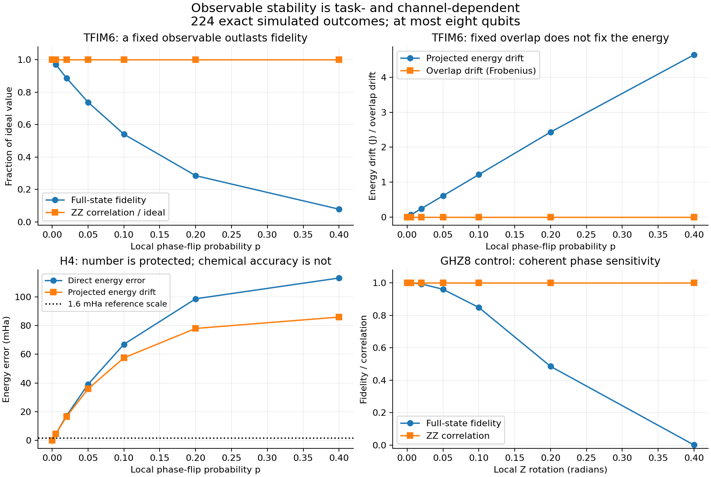

# Observable and operator-subspace stability under noise

**Finding:** particular observables can remain fixed while full-state fidelity
collapses. An invariant operator span, an unchanged overlap matrix, and even
improved conditioning do **not** establish accurate projected energies.
This is a channel-dependent effect, not a generic noise-protection property
of Clifford storage or A-CASE.

This exploratory classical simulation, dated 31 October 2026, retains all
224 declared case/channel/strength combinations. The result-free
[design](observable_noise_design.json) describes the grid; it was developed
alongside small controls and is **not a preregistered confirmatory test**.
The [compressed record](observable_noise_results.json.gz) contains every
observable, span diagnostic, overlap spectrum and same-arm Ritz comparison.



## Evidence on the declared inputs

F is squared Uhlmann fidelity against the original pure target,
`F = <psi|E(|psi><psi|)|psi>`. Local probability means a phase-flip probability
for dephasing, a total nonidentity-Pauli probability for depolarizing, and
|1> decay probability for damping. Coherent strength is an angle in radians.

| Input and noise | F | Preserved quantity | Quantity that changes |
| --- | ---: | --- | --- |
| TFIM6, independent dephasing p=0.4 | 0.0784113 | `<Z0 Z1>=0.4182971`; diagonal-arm S drift <5e-16, condition 2.43818 | Direct energy error 4.86199 J; diagonal-arm Ritz drift 4.64282 J |
| Hubbard dimer, dephasing p=0.4 | 0.3856000 | `<Z0 Z1>=-0.7071068`, particle number 2; diagonal-arm overlap condition 5.82843 | Direct energy error 1.35765 t; diagonal-arm Ritz drift 0.828427 t |
| GHZ8 Ising control, local Z rotations theta=0.4 | 0.0008526 | `<Z0 Z1>=1`, Ising energy -7, diagonal-arm projected S/H | GHZ relative phase and state fidelity |
| H4, dephasing p=0.005 | 0.9964909 | Number 4; diagonal correlators and diagonal-arm S | Direct energy error 4.47141 mHa; diagonal-arm Ritz drift 4.42980 mHa |
| H4, depolarizing p=0.2 | 0.3045258 | All three diagonal-arm overlap modes remain retained | Direct energy error 0.704625 Ha; diagonal-arm Ritz drift 0.568890 Ha |

H4 uses the existing STO-3G R=0.9 FCIDUMP, with its core-energy convention,
in the N=4, Sz=0 sector. Hubbard uses two sites, t=1, U=4 and mu=U/2.
TFIM uses open boundaries, J=1, h=1.2. Exact ground vectors initialize the
physical-model **assessment** cases; no exact oracle is proposed for a
production consumer. Total spin is not independently certified in this study.
The plus/GHZ diagonal Ising Hamiltonians are deliberately constructed controls.

The H4 example also warns against using high fidelity as an accuracy guarantee:
the p=0.005 errors already exceed the illustrative 1.6 mHa chemical-accuracy
scale. Conversely, H4's diagonal overlap condition improves from 129.815 to
10.6918 under p=0.2 depolarizing noise while its energy becomes much worse.
Noise-induced population mixing can improve a condition number without
improving the target calculation.

## Why the separation occurs

For any channel E and observable O,

`Tr[E(rho) O] - Tr[rho O] = Tr[rho (E†(O)-O)]`.

Thus E†(O)=O preserves the expectation for **every** input state, independently
of state fidelity. The new `observable_defect` reports both normalized
Hilbert--Schmidt change and a Pauli-coefficient l1 upper bound on the worst-state
expectation bias. A zero expectation in just one state is insufficient evidence:
the tests include zero-mean observables that change as operators.

Independent dephasing fixes every I/Z word exactly. A word with w X/Y factors
is multiplied by `(1-2p)^w`. Independent depolarizing multiplies a weight-w
nonidentity Pauli word by `(1-4p/3)^w`. These formulas follow directly from
Pauli conjugation and match the existing channel probability conventions.

This also explains a less absolute separation: for the plus8 product control
under depolarizing p=0.02, F=0.898181 while `<X0>=0.973333` (ideal 1).
In general F=`(1-2p/3)^n` for this product target, whereas a fixed-weight local
observable has attenuation independent of spectator count. The local
observable is approximately stable here, not exactly protected.

The mechanism is established in the literature on preserved information and
observable algebras. This experiment does not claim a new preservation theorem:
see [Blume-Kohout et al., PRL 100, 030501 (2008)](https://doi.org/10.1103/PhysRevLett.100.030501)
and [Beny, Kempf and Kribs, PRL 98, 100502 (2007)](https://doi.org/10.1103/PhysRevLett.98.100502).
Correctability with a recovery channel is distinct from the **unrecovered**
fixed-observable condition measured here.

## What the operator-span diagnostics measure

`operator_span_diagnostics` works in sparse Pauli coefficient coordinates with
inner product `Tr(A†B)/2^n`. It allocates only the union of declared input and
image supports, not a complete 4^n transfer matrix. Each input column is scaled
before SVD, and dependent generators are removed at the declared relative
tolerance. This is a numerical linear-span calculation; an arbitrary input
span need not be closed under operator multiplication or constitute an algebra.
Sparse support can itself grow exponentially under damping or coherent
rotation; avoiding a dense transfer matrix is not a polynomial-cost guarantee.

For an orthonormal input basis Q, let M=E†Q and T=Q†M.

| Diagnostic | Meaning | Limitation |
| --- | --- | --- |
| `leakage = ||M-QT||2` | Movement outside the input span | Zero leakage permits arbitrarily strong attenuation or annihilation |
| `pointwise_defect = ||M-Q||2` | Worst HS change of a unit input combination | An HS diagnostic; the separate l1 bias bound addresses expectation errors |
| Restricted singular values of T | Attenuation/amplification within the span | Unit values permit coherent rotation of observables |
| Input and image ranks; principal angle | Span dimension and geometric retention | Geometry alone does not preserve matrix elements |
| Numerical fixed dimension | Kernel count of M-Q at tolerance 1e-10 | A linear-subspace count, not a noiseless-subsystem or QEC certificate |

Three falsification controls are particularly relevant:

* Every Pauli-coordinate span is invariant under independent Pauli noise,
  yet its nonidentity words can all shrink. At depolarizing p=0.75 they vanish;
  leakage is still zero and image rank loss must be reported.
* Coherent Z rotation preserves the span of X/Y and its singular values, while
  individual X/Y expectations rotate. Zero principal angle is not fixedness.
* Damping maps `Z -> (1-gamma)Z + gamma I`. A span containing Z but excluding
  identity leaks; adding identity restores span closure without fixing Z.

## Consequences for A-CASE

Both arms keep a fixed generator list: diagonal `[I,Z0,Z1]`, mixed spin
`[I,Z0,X0]`, and mixed fermion `[I,Z0,c0†c2+c2†c0]`.
For each arm the study assesses separately the spans of
`S_ij=A_i†A_j` and `H_ij=A_i†H A_j`, their noisy expectations,
normalized overlap spectra, retained rank/condition and generalized Ritz energy.
The solver uses tau_s=1e-8 and max_condition=1e8 throughout; drift is measured
against the **noiseless same-arm** value, not relabelled as ground-state error.
Mixed-state reference matrices define the same expectation pencil, not a
reconstructed pure-state fidelity or a new pure-state variational ansatz.

Under dephasing, all diagonal-arm S observables are fixed, so their overlap
spectra and conditioning are fixed. Physical-model H rows contain transverse
or fermionic hopping terms and generally change. The TFIM/Hubbard counterexamples
show that protecting S alone is insufficient. Conserving particle number
similarly does not preserve the kinetic-energy contribution.

The supported next research direction is **noise-aware observable selection**:
rank the required S/H (and, for residual certification, H-squared) rows by
their channel defects and state-independent bias bounds, then validate the
resulting *task error*. Do not promote an operator basis solely for low
leakage, stable rank, preserved symmetries or an improved condition number.
This study does not measure H-squared, perform mitigation, or demonstrate
that this selection improves an adaptive run.

## Reproduction and validation

```bash
OPENBLAS_NUM_THREADS=1 OMP_NUM_THREADS=1 MKL_NUM_THREADS=1 python benchmarks/run_observable_noise.py --check
OPENBLAS_NUM_THREADS=1 python -m unittest discover -s tests -p test_observable_noise.py -v
python benchmarks/plot_observable_noise.py
```

The producer publishes immutable JSON/gzip bytes and refuses to overwrite an
existing output. Use `--output /tmp/observable_noise_results.json.gz` to make a
new scratch copy. `--check` binds the record to the on-disk design and named
source hashes, replays all 224 points and compares all scientific numeric fields.
It is a producer replay, **not an independent scientific checker**. Independent
validation comes from the separate tensor-axis dense Kraus implementation,
sparse Heisenberg duality at every recorded observable, analytic controls and
14 unittest cases. The maximum recorded Schrodinger/Heisenberg disagreement
is 4.37e-13. Tests reject changed values, missing outcomes, source-hash drift
and an altered case grid.

The production diagnostics never allocate density matrices. The benchmark
explicitly uses dense states at **at most eight qubits** and exact expectations.
It includes independent local post-preparation noise only; gate-resolved,
correlated, calibration, leakage and readout errors, finite shots, estimator
bias/variance, mitigation overhead and hardware runtime remain untested.
The structural CI registry replays this record on every pull request using
the shared runner and artifact receipt contract.
Historical evidence and negative cost conclusions remain unchanged.
